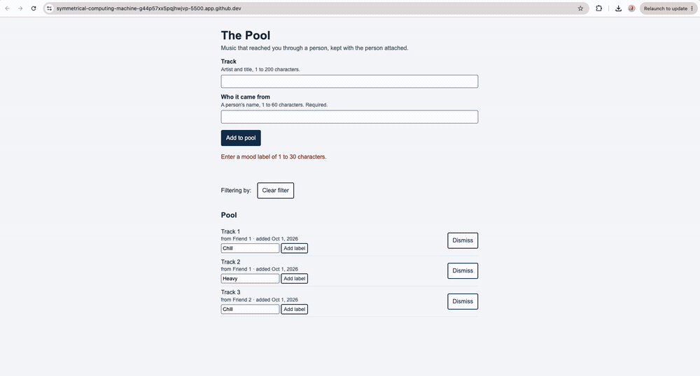

# The Pool

**One sentence:** The Pool keeps the music a person was recommended together with the name of whoever recommended it, so that a track heard once in a friend's company is still findable six months later instead of lost to the end of a listening session.

**Deployed:** [https://semajjohnson.github.io/mgt3745-final-semajjohnson/](https://semajjohnson.github.io/mgt3745-final-semajjohnson/)
**Status:** Working. The front end is served from GitHub Pages and calls a Cloudflare Worker backed by D1; all seven code evals pass against the deployed API. Incomplete: F1 and F3, automatic capture from a listening session, are deferred because no platform exposes shared-session data (ADR-001), and the pool is single-user by design (ADR-002).
**Hours spent:** 34

## See It Work



## Who It Is For

Two kinds of listener, both of whom lose music the same way. The Casual Listener hears something good in a friend's shared session, means to save it, and does not, because saving it requires presence of mind at the exact moment they are least likely to have any. The Deliberate Digger does save it, into a pile they can no longer search, because what they remember six months later is not the track title but who played it. Today's alternatives fail both: streaming platforms give algorithmic recommendations a permanent home and give human ones none. The Pool's whole premise is that the person attached to a track is the part worth keeping, and the part every other tool throws away.

## Run It

```bash
npm install
npm test                                   # 7 code evals against the deployed API
API=http://127.0.0.1:8787 npm test         # or against a local Worker
npm run dev                                # local Worker on 127.0.0.1:8787
npm run deploy                             # deploy the Worker
```

Open `index.html` with Live Server for the front end. It calls the deployed API, so no local Worker is needed to use it.

Deploying from a clean checkout needs a Cloudflare account and your own D1 database; `docs/DEPLOY.md` has the steps and the one that catches people out.

## The Record

| Artifact | Link |
|---|---|
| Problem and success measures | [context/PROJECT.md](context/PROJECT.md) |
| Users and jobs | [context/USERS.md](context/USERS.md) |
| Features (EARS rows) | [context/FEATURES.md](context/FEATURES.md) |
| Architecture | [context/ARCHITECTURE.md](context/ARCHITECTURE.md) |
| ADR-001: build by hand, no platform API | [docs/ADR-001.md](docs/ADR-001.md) |
| ADR-002: move storage to a Worker and D1 | [docs/ADR-002.md](docs/ADR-002.md) |
| Evals, RAT, Stakes, production verdict | [context/EVALS.md](context/EVALS.md) |
| **Sourcing audit: what this project trusts** | [docs/SOURCING-AUDIT.md](docs/SOURCING-AUDIT.md) |
| Trust Boundary ledger | [context/TOOLS.md](context/TOOLS.md) |
| Delegation log | [docs/DDR-LOG.md](docs/DDR-LOG.md) |
| Decision memo | [docs/DECISION-001.md](docs/DECISION-001.md) |
| Real-user feedback | [docs/FEEDBACK.md](docs/FEEDBACK.md) |
| Scaffold audits | [docs/AUDIT.md](docs/AUDIT.md) |
| Deployment notes | [docs/DEPLOY.md](docs/DEPLOY.md) |
| Self-review with Homogenization Check | [docs/SELF-REVIEW.md](docs/SELF-REVIEW.md) |

## AI Use

Claude drafted the Context Scaffold audit, both ADRs, and the sourcing audit; every claim in them was checked against the file or command it names, and the Gate scores in ADR-002 are my own judgment rather than its proposal. bolt.new and Google AI Studio each built the HW5 mood-label feature from the same specification, for comparison; bolt's output ships after I removed nine unused dependencies and two external font origins from it. GitHub Copilot is configured but no delegation in this repository cites it, which is why the sourcing audit rings it Assess rather than Adopt. Every delegation has a DDR in [docs/DDR-LOG.md](docs/DDR-LOG.md) with the verification performed and what it found.