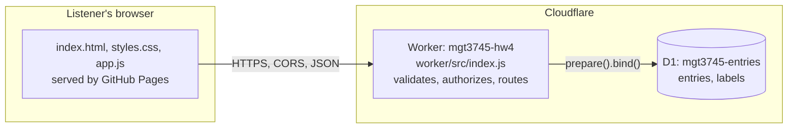

# Architecture

Status: ACTIVE in Module 3.

## Gate

**Feature under decision:** the pool — a list where every track carries the name of the person it came from, and the list survives a reload. Acceptance criterion A5 in [FEATURES.md](FEATURES.md).

### Hard constraints

An option failing either is rejected before scoring. All three options passed.

1. **No new spending.** Originally "zero budget." Reworded because Spotify's Web API now requires the app owner to hold an active Premium subscription. I already pay for Premium personally, so the marginal cost is zero — but that subscription becomes a dependency of the app, which is recorded as a consequence in ADR-001 rather than hidden here.
2. **Runs from a fresh Codespace with Live Server.** Every grader and reviewer sees the same environment.

Serving both Spotify and Apple Music users was considered as a hard constraint and deliberately demoted. As a constraint it would have rejected both Spotify-based options before scoring and left the comparison with nothing to compare. It is scored instead, through switching cost and fit to spec.

### Options

- **Hand-built option (Build):** hand-written HTML, CSS and JavaScript with `localStorage`. Tracks and source names are entered by hand. No platform dependency.
- **Existing-service option (Buy — Spotify Web API):** tracks are selected from Spotify's catalog, and the pool stores real Spotify track IDs with a source name attached. Apple MusicKit was tested as the alternative platform; see the switching cost note.
- **AI-assisted build (Delegate):** Copilot or a coding agent builds the Spotify integration, and I inspect the result.

### Anchors
| Criterion | Weight | 1 | 3 | 5 |
|---|---:|---|---|---|
| Cost to start | 3 | New spending required | No new spending, but accounts or setup | Nothing to sign up for |
| Cost to maintain | 2 | A third party can break it unilaterally | Occasional dependency updates | Nothing external to break |
| Time to working | 3 | Weeks, or gated on outside approval | Days | Hours |
| Inspectability | 4 | I can't read it | I can read it with real effort | I wrote it and can explain every line |
| Switching cost | 4 | Leaving means redesign | Portable with rework | Plain data, no lock-in |
| Fit to spec | 5 | Doesn't meet A5 | Meets A5 with gaps | Meets A5 and respects the spec's non-goals |
| Criterion | Weight | Hand-built option | Existing-service option | AI-assisted build |

### Weighted comparison

| Criterion | Weight | Hand-built option | Existing-service option | AI-assisted build |
|---|---:|---:|---:|---:|
| Cost to start | 3 | 5 (15) | 3 (9) | 3 (9) |
| Cost to maintain | 2 | 5 (10) | 1 (2) | 1 (2) |
| Time to working | 3 | 5 (15) | 2 (6) | 3 (9) |
| Inspectability | 4 | 4 (16) | 1 (4) | 1 (4) |
| Switching cost | 4 | 5 (20) | 1 (4) | 1 (4) |
| Fit to spec | 5 | 3 (15) | 4 (20) | 3 (15) |
| **Total** (max 105) | | **91** | **45** | **43** |

## The Gate: HW4 rerun

Rerun on 2026-09-30 for one question: where should entries live now that they must survive a cleared cache? Build won at 80 against Buy 55 and Delegate 46.

The table, the per-criterion scores, and an honest note about how those scores were reconstructed live in **[docs/ADR-002.md](../docs/ADR-002.md)**, which is the decision record this rerun produced.

## Current Architecture

Two origins, one vendor each. GitHub Pages serves three static files; a single Cloudflare Worker answers five routes and talks to one D1 database. There is no file store, no model, no AI Gateway, and no third-party script: `worker/src/index.js` makes no outbound request, and its only binding is `env.DB`. If any of that changes, this diagram changes in the same pull request as the ADR that changes it.

The Worker is still named `mgt3745-hw4` because `app.js` hardcodes its URL; renaming it would change the deployed address. Cosmetic, and tracked for the final package.

## Trust Boundary

The boundary sits between the listener's browser and Cloudflare. Everything to the left is code I wrote and a grader can read; everything to the right is a vendor's machine under a free personal account.

| Direction | What crosses | To whom | Who is accountable |
|---|---|---|---|
| Browser → Worker | Track name, **the name of the person it came from**, dismissal, mood labels. Plus metadata I did not choose to send: IP address, user agent, timing, paths called | Cloudflare | Me, for everything sent. Cloudflare only for running the code I deployed. |
| Worker → D1 | The same rows, written through `prepare().bind()` | Cloudflare | Me |
| D1 → Worker → Browser | Undismissed entries and their labels | Back to the listener | Me |
| Nothing | No outbound request leaves the Worker | — | — |

**The crossing that matters.** The names stored are real people who never consented to being recorded and have no route to ask for removal. That is the sharpest unresolved exposure in this project, it is why the sourcing audit weights institutional fit at 30, and it is why D1 is ringed **Trial** rather than Adopt. Every crossing is itemised in [TOOLS.md](TOOLS.md).

**What is a structure and what is only an instruction.** Rejecting an entry with no source name is a *structure*: the database column is `NOT NULL` and the Worker returns 400 before the insert, so no client can bypass it. "Never write a credential into a file" is an *instruction* in STANDARDS.md and CLAUDE.md with nothing enforcing it, which is how a live API token reached a chat window on 2026-11-10. Instructions are the ones that fail.

## ADR History

| ADR | Decision | Status |
|---|---|---|
| [ADR-001](../docs/ADR-001.md) | Build the pool by hand, no platform API, `localStorage` | Superseded by ADR-002 on 2026-09-30 |
| [ADR-002](../docs/ADR-002.md) | Entries move to a Cloudflare Worker and D1 | **Accepted.** The architecture above. |

Both ADRs carry the Gate, the options, the decision, a negative consequence, and a reversal trigger. They were moved out of this file into `docs/` on 2026-11-12 so there is one copy of each rather than three; the verdict that prompted the move is in [docs/AUDIT.md](../docs/AUDIT.md).

Reviewed against the project's dependencies in [docs/SOURCING-AUDIT.md](../docs/SOURCING-AUDIT.md), Audit 1, 2026-11-12. Nothing in that audit changed either decision.